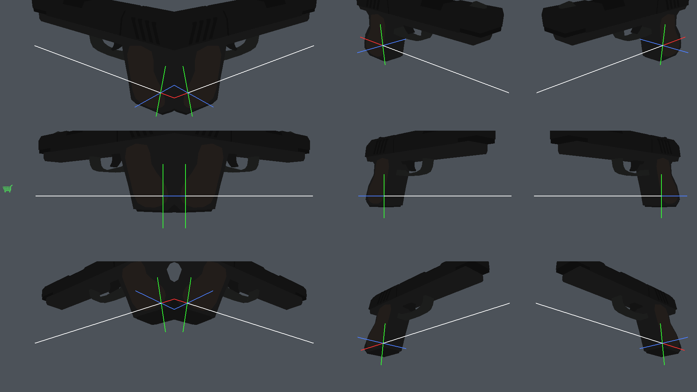
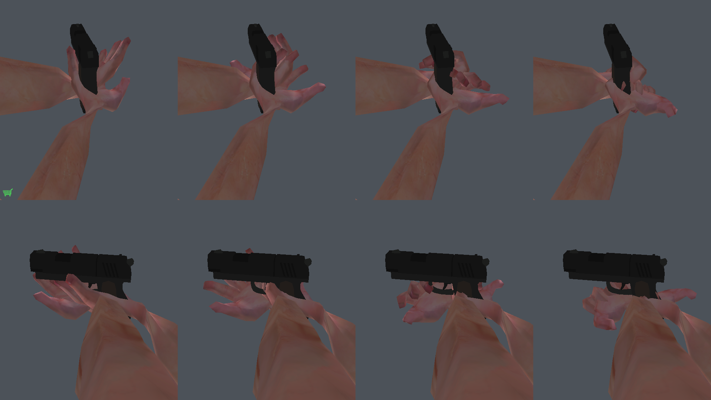

# CS 1.6.1

**An open-source Counter-Strike 1.6 distribution that is built to be modified.** The whole
stack — engine, dedicated server, game DLL, client — is compiled from source and runs on
Linux, and on top of it this project adds independent, runtime-switchable **VR**, **Jev bots** and **x-ray debug** mods,
with separate in-game diagnostic panels.

The name is the point: this is a fork, not a re-release. A `1.6.1` that grows.

> **Not affiliated with Valve.** Counter-Strike's game content (maps, models, sounds) is
> Valve's property and is **not** distributed here — the build downloads it from Valve's own
> CDN with SteamCMD, exactly as the official client does. See
> [CREDITS.md](CREDITS.md#what-is-not-in-this-repository).

---

## What it does that CS 1.6 doesn't

### Play it in VR

The engine does not have a viewmodel you can move — it draws a 1999-era gun glued to the
camera, with the arms baked into the model. This project replaces that entirely: the game
stops drawing its viewmodel and the Mod draws **its own skinned arms and weapon**, driven by
your controllers, with the whole interaction model modern VR games use.

<p align="center">
  
  
</p>

<p align="center"><em>Left: the weapon fit, from the Mod's own diagnostic mode — the red/green/blue
cross is the grip anchor, the white line runs grip&rarr;muzzle. Right: the same hand at four grip
levels — 0, &#8531;, &#8532;, 1 — closing toward the palm; the two rows are the two hands. Both images
were rendered by the game through its normal drawing path, with no headset attached.</em></p>

- **Your hands are the game's hands.** Two-bone IK per arm to your controllers, and the 30
  finger bones are driven by a flexion axis *derived from the rig's own rest pose* — so the
  hands close correctly on both sides without hand-authored per-finger data.
- **A holster on your belly, and the floor.** The match starts with the pistol in hand. Let
  go near your waist and it stays in the holster; let go anywhere else and it falls to the
  ground and lies there. Grab it again with either hand.
- **Two hands on the grip.** Squeeze both grips with both hands near the weapon and the
  support hand snaps to the grip, the weapon drives the hand, and the aim blends toward the
  two-handed line.
- **The trigger only works when you're holding the gun.** With the weapon holstered or on
  the floor, the trigger does not fire. This applies to the `pistol` class, which is the
  class the Mod draws today.
- **You aim the barrel, not the screen.** After the fit is resolved, the aim direction comes
  from the weapon's own axis, so where you point the gun is where the shot goes. Locomotion
  stays head-oriented. Reversible with `VR_AIM_FROM_WEAPON=0`.
- **Also in VR:** menus appear on a panel in front of you with your right hand as a laser
  pointer, roomscale leaning, physical crouch, snap turn, a debug panel on the monitor, and
  an IPD calibration UI you drive from the keyboard while wearing the headset.

The interesting engineering is in how the fit was solved — the weapon's size comes from a
**real length in centimetres**, the palm frame is **measured from the rig**, and the grip
anchor is **found inside the model** — rather than tuned by eyeball until it looked right.
That method, the numbers it produced, and the ten bugs it caught are in
[**docs/HANDS.md**](docs/HANDS.md).

### Bots that think with a language model

Stock CS bots are a state machine with a nav mesh. Here the bots get a **second brain**:
a sidecar process that observes the round as structured data, asks a language model (Jev)
for intent, and writes that intent back for the game DLL to apply to its bots.

- **Two brains, on purpose.** The fast half is the package’s server component, loaded by the generic ReGameDLL host:
  it publishes round snapshots and applies a plan, but never runs a model and
  never blocks a frame. The slow half is a Python sidecar that reads the observation, asks
  the model, and writes the plan back. The game keeps playing at full speed whether or not
  the brain is up.
- **Bounded by design.** The model only chooses from a fixed vocabulary of intents
  (`RUSH_B`, `STACK_A`, `RETAKE_B`, …). It cannot invent an action, and it cannot move a
  bot — the game DLL translates intent into its own bot commands. A stale plan is never
  applied, and a watchdog drops the advisor back to stock behaviour if anything stalls.
- **Measured, not assumed.** The cost of asking the model, the hit rate, and what the
  advisor changes are all logged, and the numbers are in
  [**docs/BOTBRAIN.md**](docs/BOTBRAIN.md) — including the cases where the bot does nothing
  useful.

## How it is built

CS 1.6's source is four separate open-source projects. This stack compiles all four and
inserts two of its own layers between them:

```text
Xash3D (64-bit) + generic client host + in-game tools
  └─ game/mods/<id>/client.so       ← SDK v9
ReHLDS / ReGameDLL (32-bit) + generic server host
  └─ game/mods/<id>/server.so       ← SDK v1
Local session supervisor
  └─ package-declared sidecars     ← bots-jev asks Jev off-process
Shared state: game/mod-state/<id>/ (session-tagged atomic mailboxes)
```

Two upstreams are modified, and both modifications are published here as patches against a
pinned base revision — see [patches/](patches/):

| Patch | What it adds |
|---|---|
| [`xash3d-fwgs-mod-abi`](patches/xash3d-fwgs-mod-abi/) | The **external Mod system**: a versioned C ABI, multi-package loader, per-view rendering, input hooks and integrated debug tools |
| [`regamedll-mod-host`](patches/regamedll-mod-host/) | The generic **server mod host**, small bot operations and first-spawn equipment fix |

The other two — ReHLDS and CS16Client — are used **unmodified**. Every client-side VR
feature (barrel aim, snap turn, roomscale crouch, controller input) goes through the engine's
Mod ABI, so the client DLL did not have to change.

## Quick start

You need Linux, rootless Podman, and about 15 GB. **Full instructions, including the two
upstream patches and the four builds, are in [docs/BUILD.md](docs/BUILD.md).**

```bash
# 1. game content (Valve, via SteamCMD, anonymous) + the four source trees + patches  -> docs/BUILD.md
# 2. build everything
./scripts/build-regamedll.sh     # dedicated server game DLL  (32-bit)
./scripts/build-xash.sh          # engine                      (64-bit)
./scripts/build-cs16.sh          # client                      (64-bit)
./scripts/build-openxr.sh        # OpenXR loader for the VR package
./scripts/build-mods.sh          # all independent packages
./scripts/setup-mods.sh          # private sidecar environments

# 3. play
./scripts/run-cs.sh                                      # flat + Jev bots + x-ray
(cd game && ./run-cs.sh -nomods)                         # flat reference
./scripts/run-cs-vr.sh                                   # VR + bots + headset, one command
CS_BOTS=0 ./scripts/run-cs-vr.sh                         # VR without the bot server
```

Controls, environment variables and tuning knobs are in the [VR section of the
documentation](docs/HANDS.md).

## Mods and debugging

Copy packages into `game/mods/<id>/` and restart to install; remove a package and
restart to uninstall. User settings and logs stay in `game/mod-state/<id>/`.
**F6** opens the manager, **F7** hides/shows panels, **F8** toggles the selected mod.
Esc also makes visible panels clickable while the native game menu is open.
Each mod also has configurable direct shortcuts. Activation and panel visibility
are independent. The default development profile is flat, with Jev and x-ray
active and VR disabled. Disabling Jev keeps the bots playing with stock AI.

The client SDK is **v9**, the server SDK **v1**. The hosts provide generic lifecycle,
capability ownership, logs, UI and copied snapshots; each package owns its policy.
See [docs/XRAY.md](docs/XRAY.md) for the SDK-only example and
[docs/VALIDATION.md](docs/VALIDATION.md) for verification.

## Documentation

| Document | What it is |
|---|---|
| [docs/HANDS.md](docs/HANDS.md) | The VR Mod: arms, hands, weapon fit, holster, two-handed grip, barrel aim — and the offline verification method |
| [docs/BOTBRAIN.md](docs/BOTBRAIN.md) | The two-brain bot AI, the file protocol, the Jev sidecar, measured costs |
| [docs/MODS.md](docs/MODS.md) | The **Mod ABI reference** — read this before writing a Mod |
| [docs/BUILD.md](docs/BUILD.md) | Reproducing the stack from upstream sources |
| [PLAN.md](PLAN.md) | The roadmap and engineering log: every phase, its acceptance criteria, measured results, root causes of bugs found, and what is still unverified |
| [CONTRIBUTING.md](CONTRIBUTING.md) | Ground rules, how to add a Mod, how to test without a headset |
| [CREDITS.md](CREDITS.md) | Assets, libraries, upstreams and licenses |

## Repository layout

```
mods/            the Mods this project adds
  vr/            the VR Mod (OpenXR): source, assets, cfg, diagnostic tools
  null/          minimal template Mod — copy this to start your own
  bots-jev/      removable server policy + Python sidecar + debug panel
  x-ray-debug/   SDK-only player analysis overlay
patches/         the changes this project makes to its upstreams
docs/            SDK, builds, mods and verification evidence
sdk/            public C contracts and canonical native hosts
third_party/    pinned Dear ImGui and JSON dependencies
tools/modhost/  local session supervisor
tools/botbrain/  compatibility CLI (implementation: mods/bots-jev/)
scripts/         build and launch scripts
server/          dedicated server launcher + hand-written configs
game/            client launcher + hand-written configs
src/, game/*, server/*   NOT in version control: cloned, built, or downloaded
```

## Status

| | |
|---|---|
| VR Mod | **Playable.** Weapon fit, hands, holster, two-handed grip and barrel aim implemented and verified offline; a short list of things only a headset can confirm is at the end of [docs/HANDS.md](docs/HANDS.md) |
| Bot advisor | **Working on `de_dust2` only.** Two brains, bounded intents, watchdog; the interesting failure modes are documented |
| Flat (non-VR) game | **Unchanged** from the upstream stack, by design — every feature is gated |
| Engine Mod ABI | **v9**, sized C ABI + server ABI v1; a Mod that does not match the version is refused at load |

What is explicitly **not** done yet, and will not be started without a reason to: reload and
grenade-pin gestures, wrist roll, haptics, weapon classes other than `pistol`, VR buy menu,
and collision for a dropped weapon. The current debt list is item 6.7c of [PLAN.md](PLAN.md).

## Reference environment

Everything here was built and tuned on one machine: **Fedora Linux, rootless Podman (no
sudo at any point), NVIDIA RTX 4060, Quest 3 streamed with WiVRn over Wi-Fi.** Frame budgets,
streaming bitrates and the IPD calibration numbers in the documents come from that setup.
The code is not tied to it; the launcher defaults and some `.cfg` values are, and the
documents say so where it matters. Without a headset the game simply runs flat.

## License

**GPL-3.0** for this project's code and documentation — see [LICENSE](LICENSE). Third-party
assets and libraries keep their own licenses and are listed in [CREDITS.md](CREDITS.md);
they are all permissive and GPL-3.0 compatible.
