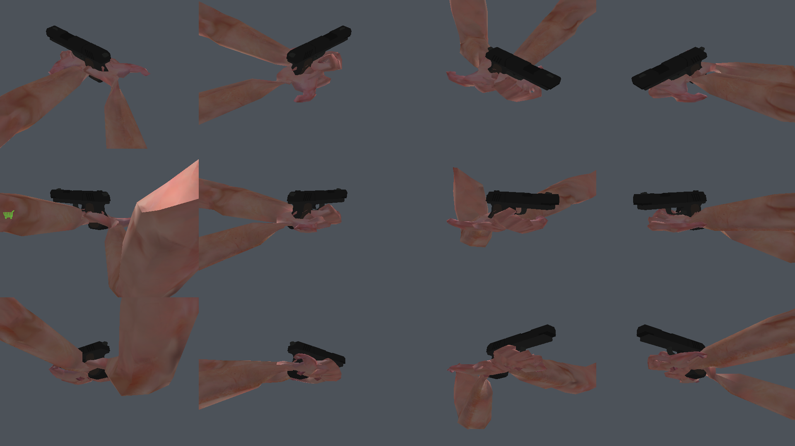

# Real hands and weapon (VR's own viewmodel) — `vr_hands`

CS's 1999 viewmodel **stops appearing in the `pistol` class** and in its place come the
**WRAD ARMS** arms with skinning and a **Quaternius** pistol, which follow the hands:
both arms do IK against the controllers, the fingers close on the grip, the weapon can go
to the **belly holster** or to the **ground**, and you can hold it with **both hands**.

It only applies where there is VR: in the flat game (monitor) the viewmodel stays the usual
one, intact.

---

## What the Mod ABI allows (and what it does not)

The ABI (v8, `engine/common/mod_api.h`) gives the Mod: `Printf`, `DoubleTime`,
`engine_version` (`:69-75`) and nothing more. There is **no** model/texture loader, command
channel, entity or physics. What exists and is used here:

| Piece | Where | What it is for |
|---|---|---|
| `mod_viewmodel_t.hide` | `mod_api.h:178` | the game stops drawing its own weapon |
| `mod_input_sample_t` | `mod_api.h:119` | absolute aim + `MOD_BTN_*` (it is the trigger gate) |
| `mod_view_t.fov_asym` | `mod_api.h:91` | asymmetric eye frustum — **in radians** |
| Eye FBO with `GL_DEPTH_COMPONENT24` | `mod_vr.cpp:2187` | the world occludes the arms for free |
| `vr_eye_cam[e]` | `mod_vr.cpp:755` | origin/angles/fov/size per eye |
| `in_hand_g[]` / `in_hand_pose[]` | `mod_vr.cpp:940` | position and pose of the controllers |

Consequences that shaped the design:

- **The server weapon is the CS weapon.** This subsystem is the visual and intention layer:
  it decides what is seen, where aim points and whether the trigger counts. It does **not**
  switch, draw or discard weapons in the inventory — the ABI has no channel for that.
- **There is no raycast**, so the "ground" of the dropped weapon is the player's own ground
  (`player_origin.z − eye height`), which already follows stairs/boxes.
- **The projectile origin stays at the eye**: the ABI does not let the shot origin be moved,
  only the direction (`viewangles_abs`). Barrel aim, eye exit.

---

## Files

| File | Role |
|---|---|
| `mods/vr/vr_hands.h` | interface: `update` (1x/frame) / `draw` (per eye) / `sheet` |
| `mods/vr/vr_hands.cpp` | the subsystem: load, fit, IK, fingers, states, drawing, sheets |
| `mods/vr/vr_hands.cfg` | calibration (hot-reload: **saving applies it**) |
| `mods/vr/assets/` | `arms.glb` + `Pistol_1.obj/.mtl` (CC0; see `assets/SOURCES.md`) |
| `mods/vr/tools/glb_inspect.py` | rig report (bones, skin, bbox) |
| `mods/vr/tools/skin_probe.cpp` | proves the skinning outside GL |
| `mods/vr/tools/ppm2png.py` | converts the mod's PPM dump to PNG (stdlib only) |

## Per-frame flow

```
VR_FramePre ──► vr_hands_frame()          [1x per frame, AFTER xrSyncActions]
                 ├─ vr_hands_body_fill()  body: eye + roomscale, torso yaw, ground
                 └─ vr_hands_update()     weapon state, IK, fingers, fit, skin
VR_Input    ◄── vr_hands_state             BARREL aim + gate of MOD_BTN_ATTACK
VR_ViewModel ──► vr_hands_covers_model()   vm->hide = 1 (only on the covered class and only in VR)
VR_AfterEyes ──► vr_hands_draw(cam)        per eye: only draws the pose already resolved
```

The `update` runs **once per frame** (not per eye): the two eyes swap the matrix and the
weapon/arm stay identical in both — otherwise the stereoscopy of what is in the hand comes
out wrong. In test mode (without headset) the `update` is called from `VR_AfterEyes`,
because outside a session there is no VR `FramePre`.

---

## The fit is solved, not guessed

This is the part that really changed in V2. What existed before was a magic multiplier and
a bone quaternion — that is how the pistol ended up **sideways, backwards and 4.2× bigger**.

**1. Asset axes, declared.** Each file has its own convention (`arms_axes`, `weapon_axes`
in the cfg): `-Z +Y +X` = forward −Z, up +Y, right +X (glTF/WRAD); `+X +Y +Z`
(OBJ/Quaternius, length on +X). Applying the same conversion to both put the pistol
crosswise.

**2. HAND frame.** The weapon is mounted in the hand frame (forward = barrel, left, up),
derived from the rig itself at load (see `assets/SOURCES.md`): the palm comes from the
average of the finger bases, and the hand rotation follows the **controller pose** —
without this the fist stayed in the rig's rest pose and the weapon had no way to get into
the hand.

**3. Grip anchored to the palm.** `weapon_grip` is a point **inside the model** (measured:
centroid of the grip of the `Pistol_1`, `−0.10 −0.23 0`). It lands exactly on the palm
centre — the report prints `empunhadura a 0.00 un da palma` (grip 0.00 u from the palm)
when this is right.

**4. Scale by the REAL length.** `weapon_length_cm` (19) ÷ the measured length of the model
(1.82) = **4.11 u/u** → the pistol comes out at **7.48 GoldSrc units = 19.0 cm**. No asset
needs a magic number, and the doubled-scale bug (the world of the `socket` bone already
carried `scale_arms` and the multiplier came on top) died at the root.

**5. Residuals that make sense.** Two taste adjustments remain, both **in the frame in which
the weapon is mounted**: `weapon_off` (GoldSrc units: forward/left/up) and `weapon_euler`
(degrees: `pitch` = **muzzle up**, `yaw`, `roll`). The `holster_euler` uses the same
convention. With the defaults, both are zero and the fit is already right.

**6. The same math for all three places.** `mount_weapon()` mounts the weapon in the hand,
in the holster and on the ground — only the frame changes. There are not three copies of the
math to diverge.

## Fingers that close

The rig has **30 finger bones** (`finger_{pinky,ring,middle,index,thumb}{1,2,3}.{l,r}`) and
the flexion axis of each phalanx is **derived from the rest pose**, with no per-asset table:
in the bone's local space the length runs along `+Y`, so rotating around
`cross(Y, direction-to-palm)` moves the fingertip **toward the palm**. It holds equally for
both hands and for the thumb. How much it closes comes from the cfg (`curl_max` per phalanx
and a weight per finger), and the hand that **holds** the weapon adds a `curl_fist`: the
fist closes on the grip even with the analog at 0.6.

## States: hand, holster, ground and two hands

```
   IN HAND ──── grip released far from the belly ───► ON THE GROUND ──── grip near ────► IN HAND
      │                                                  ▲
      └── grip released with the hand on the belly ──► IN THE HOLSTER ◄──── grip near ────┘
```

- **IN HAND** is the initial state. The **rear hand** (the one that holds the grip) is the
  one that grabbed; the other is support.
- **Two hands** when both grips are squeezed **and** the support hand is within
  `two_hand_radius` of the support anchor. The barrel becomes the direction
  `support hand → rear hand` blended with the forward of the rear hand (`two_hand_blend`),
  the rear hand rotates **along** with the weapon, and the support hand's IK aims at the
  **weapon** (the weapon drives the hand, which is the standard in games).
- **Release** only drops the weapon when **nobody** is holding it: in two hands, letting go
  of the rear one does not drop it.
- **Grab** is by grip edge + radius (`grab_radius`), with hysteresis (`grab_hyst`); it works
  with **either** hand, and the weapon switches rear hand.
- **Ground**: the weapon falls (real gravity, `drop_gravity` = 9.8 m/s²) to the player's
  ground plane and lies down (the barrel goes horizontal).
- **Holster**: sits on the belly, muzzle down (`holster_euler` = −70° → measured: the barrel
  makes **−0.94 with the body vertical**). The anchor belongs to the **body**: `player_origin`
  + roomscale, with the torso yaw — which can lag the head (`VR_BODY_YAW_LAG`), otherwise
  looking sideways turns the holster with it.

## Integration with the game

- **Barrel aim** (`VR_AIM_FROM_WEAPON`, on): the direction of the weapon in the hand is what
  goes to the server. It is what makes the two-handed grip and the draw with either hand
  agree with what is seen. Turning it off goes back to aiming by the hand/head
  (`VR_AIM_SOURCE`).
- **Trigger gate** (`enforce_armed` in the cfg, on): outside the hand the trigger does not
  fire — and this applies **only to the class this subsystem draws**; with the rifle
  equipped, nothing changes. The visual recoil only fires with the weapon in the hand.
- **Visual recoil** in the weapon's frame (backwards along the barrel + muzzle up), in
  GoldSrc units from the cfg. The recoil that deflects the shot is still the game's.

---

## Configuration (`mods/vr/vr_hands.cfg`)

Saving the file **applies it**: the mod re-reads by mtime (~1×/s) and reloads the assets —
you can adjust fit, scale, axes and the contact sheet without restarting the game.

| Key | Default | What it is |
|---|---|---|
| `enable` | 1 | 0 = back to the game's viewmodel |
| `arms_glb` / `arms_tex` / `weapon_obj` | WRAD/Quaternius assets | paths (relative to `game/`) |
| `arms_axes` / `weapon_axes` | `-Z +Y +X` / `+X +Y +Z` | convention INSIDE each file |
| `scale_arms` | 4.2 | rig → GoldSrc units |
| `weapon_length_cm` | 19 | target real length (the scale comes from here) |
| `weapon_scale_res` | 1 | multiplicative residual |
| `weapon_grip` | −0.10 −0.23 0 | grip point in MODEL space |
| `weapon_off` / `weapon_euler` | 0 | residual: GoldSrc units / degrees (pitch = muzzle up) |
| `support_fwd` / `support_side` / `support_up` | 1.6 / 1.4 / 0 | where the support hand goes |
| `curl_max` | 85 95 75 | maximum flexion per phalanx (degrees) |
| `curl_pinky`…`curl_thumb` | 1.0 1.0 0.95 0.85 0.6 | weight per finger |
| `curl_fist` | 0.75 | minimum closure of the hand that holds |
| `grip_th` | 0.6 | squeeze that counts as "squeezed" |
| `holster_fwd/down/side` | 10 / 22 / 0 | holster: forward and below the eye |
| `holster_euler` | −70 0 0 | stored pose (negative pitch = muzzle down) |
| `holster_radius` / `grab_radius` / `grab_hyst` | 9 / 7 / 1.7 | store / grab / hysteresis |
| `two_hand_radius` / `two_hand_blend` | 6 / 0.5 | entering two hands / barrel weight |
| `drop_gravity` / `drop_eye_height` | 386 / 28 | fall and ground |
| `recoil_deg` / `recoil_kick` / `recoil_interval` | 7 / 0.9 / 0.09 | visual recoil |
| `enforce_armed` | 1 | outside the hand, the trigger does not fire |
| `sheet` | 0 | contact sheet (see below) |
| `synth_hands` / `synth_grip` / `synth_dist` / `synth_side` / `synth_down` | 0 / 1 / 16 / 5.5 / 9 | diagnostic synthetic hands (16 u keeps the target inside the ~22 u reach) |
| `near` / `far` / `color_gamma` | 4 / 7086 / 2.2 | match the ref; the MTL's `Kd` is linear |

## Diagnosis without a headset: the contact sheets

`VR_HANDS_TEST=1` (or any `VR_HANDS_SHEET`) draws into the **window FBO**, and
`VR_PANEL_DUMP` saves the frame. The sheet is a **grid of views of the SAME drawing path** —
what you see is what the game draws. The views are **relative to the body** (torso yaw):
`0` = facing the player, `90` = from the left side, `180` = from behind.

| `VR_HANDS_SHEET` | Grid | To decide |
|---|---|---|
| `fit` | 4×3 angles around the hand | fit, orientation and SIZE of the weapon in the hand |
| `weapon` | 4×3, the weapon alone + markers | whether the grip point is on the grip and the axis on the barrel |
| `curl` | 4 grip levels × 2 hands | direction and amount of the finger closing |
| `states` | 2×2 | the four poses: in hand, two hands, holster, ground |
| `walk` | 4×2 | **script through the state machine** (grab/store/release/2 hands) |

In `weapon` mode the markers are lines: **red** = barrel axis, **green** = side,
**blue** = weapon up, **white** = length (at real scale). They prove the anchors.

<p align="center">
  
</p>

<p align="center"><em>The <code>weapon</code> sheet, which is what the fit is judged on: red/green/blue
is the mount frame, white is the grip&rarr;muzzle line at real scale, and the anchor sits in the grip
instead of beside it. This render is what caught two of the bugs in the list at the end of this
document.</em></p>

<p align="center">
  
</p>

<p align="center"><em>The <code>curl</code> sheet: grip at 0 / ⅓ / ⅔ / 1, with the weapon (top) and empty
(bottom). The closing direction is derived, not authored — it comes out correct for both hands and for
the thumb because the axis is computed from the rig's own rest pose.</em></p>

**About the arms in the sheets.** In test mode there are no controllers: the hands sit at the
synthetic positions from the cfg (`synth_dist/side/down`). Two consequences worth knowing before
you judge an image:

- the **support (left) hand** is placed across the body, the way a real two-handed grip is, so its
  arm is close to full extension — and a nearly straight arm, seen from a camera sitting on the
  hand, reads as a wide foreshortened shape. The `braco:` line reports the numbers (`alvo` vs
  `alcance`, and the elbow bend), so you can tell "the arm is at full stretch because the target is
  far" from "the chain is wrong";
- the fixture values are deliberately chosen **inside** the arm's reach (~22 u). An out-of-reach
  target forces the arm straight and makes the sheets useless for judging the pose.

They are the right tool for the weapon's fit, size and position — that is what they exist for.

<p align="center">
  
</p>

<p align="center"><em>The raw <code>fit</code> sheet, unedited, so the caveat above is not a claim you
have to take on faith. This is exactly what a regenerated sheet looks like with no headset attached:
the firing hand grips the pistol in all twelve views, and the support arm crosses the frame at full
extension, as it does in a real two-handed grip.</em></p>

The same drawing prints a **numeric report** in the log — it is what allows deciding without
looking at the image:

```
maos: folha 'fit' 4x3 | escala 4.11 un/un | comprimento real 19.0 cm | estado na mao
maos: encaixe: cano x frente-da-mao = 0.0 graus | empunhadura a 0.00 un da palma | arma 7.48 un (19.0 cm)
maos: coldre: cano x cima-do-corpo = -0.94 (cfg pitch -70) | cano x frente = +0.34
```

And `walk` mode runs the state machine for real, step by step:

```
maos: passo 0: grip esq 0.00 dir 1.00 -> na mao | mao de tras dir
maos: passo 1: grip esq 0.00 dir 0.00 -> no chao | mao de tras dir
maos: passo 3: grip esq 1.00 dir 0.00 -> na mao | mao de tras esq      (pegou do chão com a esquerda)
maos: passo 4: grip esq 1.00 dir 1.00 -> na mao | mao de tras esq +2 maos
maos: passo 5: grip esq 0.00 dir 1.00 -> na mao | mao de tras esq +2 maos  (soltar a de trás não derruba)
maos: passo 6: grip esq 0.00 dir 0.00 -> no coldre | mao de tras esq   (levou à barriga)
maos: passo 7: grip esq 0.00 dir 1.00 -> na mao | mao de tras dir      (sacou de novo)
```

Recipe (from `game/`, which is xash3d's cwd — needs X11):

```sh
cd game
VR_HANDS_SHEET=fit VR_DEBUG_PANEL=0 VR_PANEL_DUMP=/tmp/fit.ppm VR_PANEL_DUMP_AT=12 \
  SDL_VIDEODRIVER=x11 ./xash3d -game cstrike -mod vr +map de_dust2
python3 ../mods/vr/tools/ppm2png.py /tmp/fit.ppm /tmp/fit.png
```

Other useful variables: `VR_HANDS_FAKE_MODEL=models/v_usp.mdl` (injects the viewmodel name
without an equipped weapon), `VR_AIM_FROM_WEAPON=0`, `VR_BODY_YAW_LAG=0.25`,
`VR_WEAPON_DEBUG=1`.

## Verified without a headset

| What | How | Result |
|---|---|---|
| Asset loading | load log | 1196 tri / 872 verts / 50 bones + 1040 tri for the weapon |
| Palm frame | load log | 0.37 u from the fist rig, normal to the body in both hands |
| Fit in the hand | `fit` sheet + report | barrel at **0.0°** from the hand forward; grip at **0.00 u** from the palm |
| Size | `fit` sheet + report | **7.48 u = 19.0 cm** (was ~32 u) |
| Anchors | `weapon` sheet | cross on the grip, white line along the barrel |
| Fingers | `curl` sheet | close toward the palm, at all 4 levels, **in both hands** |
| Holster | report + `states` sheet | barrel at **−0.94** from the body vertical (muzzle down) |
| States | `walk` sheet + log | **8/8** steps: grab (left), 2 hands, release the rear one, store, draw (right) |
| Mesh follows the pose | report: `mao:` line | wrist mesh vs IK target **0.00/0.00 u**; mesh palm centre vs hand frame **0.00/0.00 u** (see note 11) |
| Arm is not over-extended | report: `braco:` line | target 23.4/16.9 u against a reach of 21.9 u → support arm extended, firing arm bent 79° |
| Flat did not regress | game without `VR_HANDS_TEST` | no line from the subsystem in the log; mod loads normally |

The last two rows exist because of a bug that images alone did not pin down: the **wrist bone's
world matrix** was being built with the *rest position* of the wrist baked into it, which threw the
hand mesh ~26 u (66 cm) away from where the IK had put the wrist. The bones kept their lengths, so
no bone-length check would have caught it — only comparing **where the skinned mesh lands** against
**where the math says it should** does. Those two numbers are now printed on every report and must
read `0.00`; they are the regression test for the whole class.

### Still to validate with the headset (your side)

1. Size and orientation of the pistol in the hand (it is `weapon_length_cm` and the `weapon_euler`).
2. Closing the hand with the grip (`curl_fist` is the minimum when it holds the weapon).
3. Draw from the holster and store (the holster is 10 u forward and 22 below the eye).
4. Two hands: if the fit of the support hand needs adjustment, it is `support_fwd/side/up`.
5. Grab from the ground and switch hands.
6. Barrel aim: if you prefer the previous one, `VR_AIM_FROM_WEAPON=0`.
7. If the holster bothers you when looking sideways, turn on `VR_BODY_YAW_LAG=0.25`.

## Limits of this version

- Only the **`pistol`** class (usp, glock18, p228, deagle, elite, fiveseven) and a single
  arms+weapon pair. The other classes stay exactly as before.
- **No reload, no grenade-pin gesture, no haptics and no sound.** The request was to aim and
  fire by motion — and that is what is here.
- **The inventory belongs to the game.** Store/release is client state (what is seen and
  whether the trigger counts); the weapon equipped on the server does not change. The
  dropped weapon also does not survive a map change and has no collision with the world.
- The projectile **origin** stays at the eye (the ABI does not let it be moved) — only the
  direction comes from the barrel.
- The fist rotates as a rigid body (the controller rotation goes into the wrist bone): there
  is no forearm twist.
- Skinning on the **CPU** in immediate mode: ~2,200 tri, 1×/frame. If it ever becomes heavy,
  the path is vertex arrays, without changing the rest.

## Engineering notes (bugs that cost time)

1. **`fov_asym` is in RADIANS** (the ABI delivers it that way and `proj_matrix` applies
   `tan()`). Storing the tangent applied `tan` twice and flattened the model.
2. **The inverse has to be general, not "rigid".** The rig's world matrices carry the scale
   (`scale_arms`); the inverse that assumes an orthonormal rotation generated locals with
   translations of hundreds of units and the mesh exploded.
3. **The skin is already in world space.** The `cur[root]` includes the rig placement, so the
   arms drawing enters with the **identity** matrix — applying the placement again threw the
   arms far away (the weapon, which has no skin, stayed right).
4. **Immediate mode with *client arrays* enabled is discarded.** `ref_gl` draws the world
   with vertex arrays; disabling everything before `glBegin` avoids discarded vertices.
5. **"Nothing appeared in VR" — the hiding gate and the drawing gate disagreed.** The block
   that writes the viewmodel name (`vr_wpn_model`) was *after* the `return` that hides the
   game's viewmodel: the game hid its weapon and `VR_AfterEyes`, which queried
   `vr_wpn_model` (still `"-"`), never drew. Today there is **a single decision**
   (`vr_hands_draw_ours`), made before any `return`.
6. **Column 0 of a column-major matrix is `(m[0] m[1] m[2])`.** Using row 0
   (`m[0] m[4] m[8]`) made the diagnostic report **86° of error** on a fit that was right —
   it cost a whole contact sheet of investigation.
7. **The residual rotates in the LOCAL space of the frame in which the weapon is mounted.**
   Before, it used the frame's world vector: with the body turned to +X it worked and outside
   that the −70° holster came out at **≈16°** (the pistol practically lying on the belly).
8. **The finger average divides by HOW MANY fingers were summed.** Dividing by 3 with 4
   fingers summed inflated the "palm forward" by 4/3 and threw the fit out of place.
9. **The `test_nodepth` of the diagnostic leaked into the game** (without depth the weapon
   went through walls in VR); today the test mode is explicit (`vr_hands_set_test_mode` was
   replaced by an explicit sheet mode).
10. **In test mode the `update` did not run**: it was only inside the `VR_FramePre` session
    block, which does not exist without a headset. The contact sheet stayed blank.
11. **The hand bone's world matrix carried the wrist's REST POSITION.** The wrist is the only
    bone whose world is written from outside the chain (the IK places the forearm; the
    controller decides the hand's rotation), and it was computed as
    `inv(forearm) . P_hand . rest_world[wrist]` — with the *whole* rest matrix, translation
    included. The rig's rest positions are absolute body coordinates (the wrist sits ~6 units
    from the rig origin), and the skin is `cur_world . ibm`, so that translation does **not**
    cancel: it landed the hand mesh at `wrist + 4.2 . Rw . p_rest`, roughly **26 u (66 cm) past
    the wrist**. The bones still had their correct lengths, so the skeleton looked fine while
    the skin stretched from the (correct) forearm to the (displaced) hand — reported from the
    headset as *"the shoulder and upper arm are great, the forearm is stretched and gigantic,
    and the hand is way out there"*. The fix is to use only the **rotation** of the rest matrix
    (`rest_world[wrist]` with its translation zeroed), which makes the skin exactly
    `T(wrist) . S(s) . Rw . T(-p_rest)`: rotate the hand about its own wrist and put the wrist
    where the IK put it. Two numbers now guard it — see the `mao:` report line.
12. **The palm centre was stored as an ABSOLUTE rig coordinate.** Same family as 11, one level
    up: `palm_ctr` was `wrist + fwd * 0.55 d` in rig space, and the hand frame it feeds
    (`P_hand`, whose origin is the *wrist*) then added those ~6 units again — this time to the
    **weapon**, which is mounted on that frame. The pistol left the hand and floated ~27 u
    away, while the hand (fixed by 11) sat correctly on the wrist. It is now stored **relative
    to the wrist**, which is what the hand frame expects. Both errors were the same mistake:
    an absolute coordinate where a displacement was expected, in a frame whose origin is not
    the rig origin.
